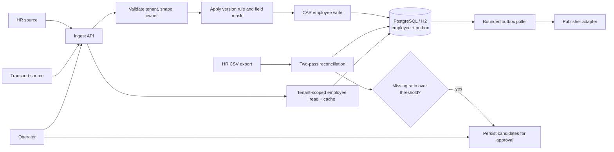
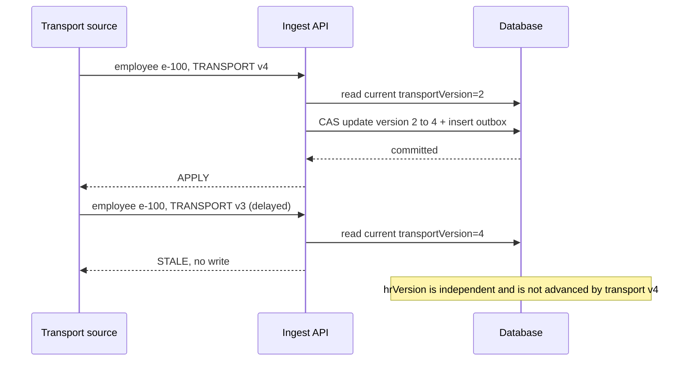

# Design and failure behavior

## Architecture

An accepted event and its outbox record are committed together. CAS uses the stored
row version so concurrent writers re-read and reapply against the latest employee.
HR and transport versions advance independently. Read caching is not consulted by
write decisions.

## Out-of-order event example

Equal versions return `DUPLICATE`; lower versions return `STALE`. Only a higher
version from that same owner can update its fields. A lost CAS causes a bounded retry
against newly read state.

## Field ownership

| Owner | Writable employee fields | Lifecycle |
|---|---|---|
| HR | `name`, `email`, `managerId`, `officeCode`, `status` | HR `DEACTIVATE` sets status inactive |
| TRANSPORT | `pickupPoint`, `specialAssistance` | No lifecycle changes |

Payload fields not owned by the sender are masked. An absent key leaves a value
unchanged; an explicit `null` clears a field when the key is owned. Tenant and employee
identity scope all reads, versions, and writes.

## Failure modes and recovery

| What fails | What the caller/operator sees | Recovery |
|---|---|---|
| Missing/invalid event fields, unsupported office, or tenant mismatch | Per-record `REJECTED` result with a stable reason code; other batch records continue | Correct the source record and resend it with an advancing owner version |
| Event version is already applied or behind | `DUPLICATE` or `STALE`; no state change | No action for duplicates; source should resend the newest state with a higher version if needed |
| CAS contention exceeds retry limit | Record is rejected as a processing error; no partial employee/outbox commit | Retry the event; investigate sustained contention |
| Database unavailable during ingest | Request cannot be committed; employee and outbox remain atomic | Restore database connectivity and retry; version handling makes replay safe |
| Publisher throws while delivering outbox event | Error counter increments; row remains unpublished and stores exception class only | Poller retries on a later interval; inspect metrics and publisher health |
| Process stops after publish but before marking outbox row | Downstream may receive the same event again | Consumer deduplicates by durable event identity; delivery is at least once |
| CSV cannot be read or parsed | Reconciliation run becomes `FAILED`; no successful completion is reported | Fix export/access and launch a new run |
| Too many active employees are absent from CSV | Run is `BLOCKED_SAFETY_BRAKE`; missing rows are saved as pending candidates and not deactivated | Verify export completeness; an operator may approve the exact candidates or rerun with corrected input |
| Approval is attempted by a non-operator or for a non-pending run | `403 FORBIDDEN` or `409 RUN_NOT_APPROVABLE` | Use an operator credential and inspect the run/candidate state |
| Cache contains a value written externally | Read can be stale for up to its 30-second TTL | Wait for expiration; writes through this app evict after commit |

## Operational limits

The supplied poller assumes one application instance. Reconciliation holds employee
IDs and content hashes in memory (not full rows); substantially larger populations
should use a sorted merge join or database staging table. The benchmark in README is
an observation from one developer machine, not a capacity guarantee.
